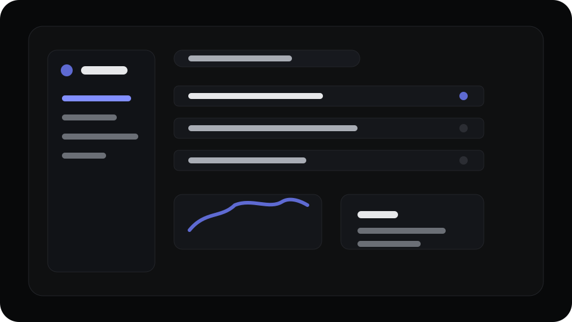

# Block Preview

This page enumerates the common Smooth Docs display blocks so the Linear theme can be checked in one place. It should feel compact, dark, quiet, and product-focused.

## Text

Linear-like prose should keep a restrained rhythm. This paragraph includes **strong text**, _emphasis_, `inline code`, [a link](https://linear.app/docs), and keyboard hints like <kbd>⌘</kbd><kbd>K</kbd>.

Use short paragraphs to verify spacing between body copy, links, and inline code without introducing oversized gaps.

---

## Headings

### Level 3 Heading

Text under a level 3 heading should be readable without the heading becoming a hero.

#### Level 4 Heading

Level 4 headings should remain compact and useful for dense docs pages.

## Lists

- Overview item with a concise line.
- Another item that wraps to a second line so line height, bullet alignment, and paragraph rhythm can be checked against the Linear theme.
- Nested structure:
    - Child item one.
    - Child item two with `inline code`.

1. First ordered item.
2. Second ordered item.
3. Third ordered item with a nested list:
    1. Nested ordered item.
    2. Another nested item.

- Mixed normal list item.
- Mixed normal list item with enough copy to verify that loose-list paragraph wrappers do not create excessive vertical spacing.

- [ ] Unchecked task item
- [x] Checked task item

## Quote

> Product work benefits from interfaces that stay calm under pressure. A docs theme should preserve focus while still making structure easy to scan.

## Callout With Raw HTML

<div class="preview-callout raycast-callout">
  <strong>Raw HTML block</strong>
  <p>This checks that raw HTML can sit naturally beside Markdown-rendered blocks.</p>
</div>

## Table

| Token      | Linear value | Usage                    |
| ---------- | ------------ | ------------------------ |
| Background | `#08090a`    | Page and navigation base |
| Panel      | `#0f1011`    | Code, cards, dialogs     |
| Border     | `#23252a`    | Hairlines and panels     |
| Brand      | `#5e6ad2`    | Primary brand accent     |
| Link       | `#828fff`    | Inline links and focus   |

## Code

```ts
type ThemeToken = {
    name: string;
    value: string;
    role: "background" | "foreground" | "accent";
};

const brand: ThemeToken = {
    name: "brand",
    value: "#5e6ad2",
    role: "accent",
};
```

```bash
smdocs run ./docs
```

## Math

Inline math should sit with text like $E = mc^2$ without changing paragraph rhythm.

$$
\int_0^1 x^2\,dx = \frac{1}{3}
$$

## Mermaid


## Accordion

::accordion
::item[Open item]{open}
This item starts open and includes **Markdown** content.

- Compact list item.
- Another compact list item.

::
::item[Closed item]
Closed content should use the same prose rhythm once expanded.

```js
console.log("accordion code block");
```

::
::

## Image



## Pages

- [Getting started](./getting-started.md)
- [Theme example](./theme-example.md)
