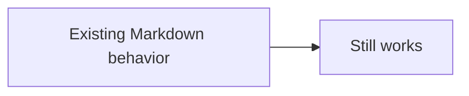

# Interactive Flow

This paragraph is a round-trip sentinel before the editable workflow. It must remain byte-for-byte
unchanged when the diagram is saved.

```smooth-flow
# This comment must remain attached to the workflow after visual editing.
version: 1
id: parking-start-inline
kind: workflow
title: Parking start
description: A four-step example used to verify visual editing and safe Markdown round trips.
direction: right
lanes:
  - id: user
    label: Driver
    description: Actions performed by the parking customer.
  - id: backend
    label: Backend
  - id: external-system
    label: External systems
nodes:
  # Retained node comments should survive stable-ID reconciliation.
  - id: scan
    type: action
    label: Scan QR code
    description: Read the parking location QR code.
    lane: user
    owner: Driver
    status: ready
    risk: low
    links:
      - kind: docs
        href: ./getting-started.md
        label: Getting started
    position:
      x: 40
      y: 80
  - id: validate
    type: decision
    label: Is the code valid?
    description: Verify the signed location payload.
    lane: backend
    owner: Parking API
    status: active
    risk: medium
    position:
      x: 360
      y: 80
  - id: create-session
    type: service
    label: Create parking session
    lane: backend
    owner: Parking API
    position:
      x: 680
      y: 80
  - id: authorize-payment
    type: external
    label: Authorize payment
    lane: external-system
    owner: Payment provider
    links:
      - kind: external
        href: https://example.com/payments
        label: Payment documentation
    position:
      x: 1000
      y: 80
edges:
  - id: scan-to-validate
    from: scan
    to: validate
    label: QR payload
  - id: validate-to-session
    from: validate
    to: create-session
    label: Valid
  - id: session-to-payment
    from: create-session
    to: authorize-payment
    style: async
  - id: invalid-to-rescan
    from: validate
    to: scan
    label: Invalid
    style: error
stories:
  - id: happy-path
    label: Happy path
    description: A successful parking-session start.
    steps:
      - node: scan
      - edge: scan-to-validate
      - node: validate
      - edge: validate-to-session
      - node: create-session
      - edge: session-to-payment
      - node: authorize-payment
  - id: error-path
    label: Error path
    description: An invalid code sends the driver back to scan again.
    steps:
      - node: scan
      - edge: scan-to-validate
      - node: validate
      - edge: invalid-to-rescan
      - node: scan
```

## Reusable external workflow

The same authored workflow is reused from another page with a different initial path and height.

```smooth-flow
src: ./flows/parking-start.docs-flow.yml
view: normal-path
height: 520
```

This paragraph is the round-trip sentinel after the workflow. Mermaid and ordinary code fences must
continue to render normally beside the new block.



## Reader exploration fixture (20 nodes)

Use this larger workflow to verify label and description search, node details, direct relations, and
upstream/downstream focus without entering edit mode. Searching for `customer-facing delivery`
matches a description that does not appear in a node label.

```smooth-flow
version: 1
id: payment-reader-exploration
kind: workflow
title: Payment reader exploration
description: A twenty-node reader fixture for search, inspection, and path focus.
direction: right
lanes:
  - id: client
    label: Client
  - id: api
    label: API
  - id: provider
    label: Payment provider
  - id: archive
    label: Archive
nodes:
  - id: receive-request
    type: action
    label: Receive request
    description: Accept a new payment request from the checkout page.
    lane: client
  - id: validate-request
    type: decision
    label: Validate request
    description: Check the submitted account and amount.
    lane: api
  - id: risk-review
    type: service
    label: Risk review
    description: Evaluate fraud rules before authorization.
    lane: api
  - id: authorize-payment
    type: external
    label: Authorize payment
    description: Request an authorization hold from the payment provider.
    lane: provider
    owner: Payments team
    status: active
    risk: high
    links:
      - kind: external
        href: https://example.com/payment-authorization
        label: Authorization guide
  - id: capture-funds
    type: service
    label: Capture funds
    description: Capture an approved authorization.
    lane: provider
  - id: decline-request
    type: action
    label: Decline request
    description: Record the provider rejection.
    lane: api
  - id: create-receipt
    type: service
    label: Create receipt
    description: Create the final receipt after capture.
    lane: api
  - id: notify-customer
    type: action
    label: Notify customer
    description: Send the completed receipt.
    lane: client
  - id: write-audit
    type: note
    label: Write audit record
    description: Retain the customer-facing delivery result for support.
    lane: api
  - id: archive-step-1
    type: service
    label: Archive step 1
    description: Begin long-term archival processing.
    lane: archive
  - id: archive-step-2
    type: action
    label: Archive step 2
    lane: archive
  - id: archive-step-3
    type: service
    label: Archive step 3
    lane: archive
  - id: archive-step-4
    type: action
    label: Archive step 4
    lane: archive
  - id: archive-step-5
    type: service
    label: Archive step 5
    lane: archive
  - id: archive-step-6
    type: action
    label: Archive step 6
    lane: archive
  - id: archive-step-7
    type: service
    label: Archive step 7
    lane: archive
  - id: archive-step-8
    type: action
    label: Archive step 8
    lane: archive
  - id: archive-step-9
    type: service
    label: Archive step 9
    lane: archive
  - id: archive-step-10
    type: action
    label: Archive step 10
    lane: archive
  - id: archive-step-11
    type: service
    label: Archive step 11
    description: Complete the archival retention chain.
    lane: archive
edges:
  - id: receive-validate
    from: receive-request
    to: validate-request
    label: Submit
  - id: validate-authorize
    from: validate-request
    to: authorize-payment
    label: Validated
  - id: receive-risk
    from: receive-request
    to: risk-review
    label: Screen
  - id: risk-authorize
    from: risk-review
    to: authorize-payment
    label: Approved risk
  - id: authorize-capture
    from: authorize-payment
    to: capture-funds
    label: Approved
  - id: authorize-decline
    from: authorize-payment
    to: decline-request
    label: Rejected
    style: error
  - id: capture-receipt
    from: capture-funds
    to: create-receipt
    label: Captured
  - id: receipt-notify
    from: create-receipt
    to: notify-customer
    label: Receipt ready
  - id: notify-audit
    from: notify-customer
    to: write-audit
    label: Delivered
  - id: audit-archive
    from: write-audit
    to: archive-step-1
    label: Archive
    style: async
  - id: archive-1-2
    from: archive-step-1
    to: archive-step-2
  - id: archive-2-3
    from: archive-step-2
    to: archive-step-3
  - id: archive-3-4
    from: archive-step-3
    to: archive-step-4
  - id: archive-4-5
    from: archive-step-4
    to: archive-step-5
  - id: archive-5-6
    from: archive-step-5
    to: archive-step-6
  - id: archive-6-7
    from: archive-step-6
    to: archive-step-7
  - id: archive-7-8
    from: archive-step-7
    to: archive-step-8
  - id: archive-8-9
    from: archive-step-8
    to: archive-step-9
  - id: archive-9-10
    from: archive-step-9
    to: archive-step-10
  - id: archive-10-11
    from: archive-step-10
    to: archive-step-11
stories:
  - id: happy-path
    label: Happy path
    steps:
      - node: receive-request
      - edge: receive-validate
      - node: validate-request
      - edge: validate-authorize
      - node: authorize-payment
      - edge: authorize-capture
      - node: capture-funds
      - edge: capture-receipt
      - node: create-receipt
      - edge: receipt-notify
      - node: notify-customer
  - id: decline-path
    label: Decline path
    steps:
      - node: receive-request
      - edge: receive-validate
      - node: validate-request
      - edge: validate-authorize
      - node: authorize-payment
      - edge: authorize-decline
      - node: decline-request
```
